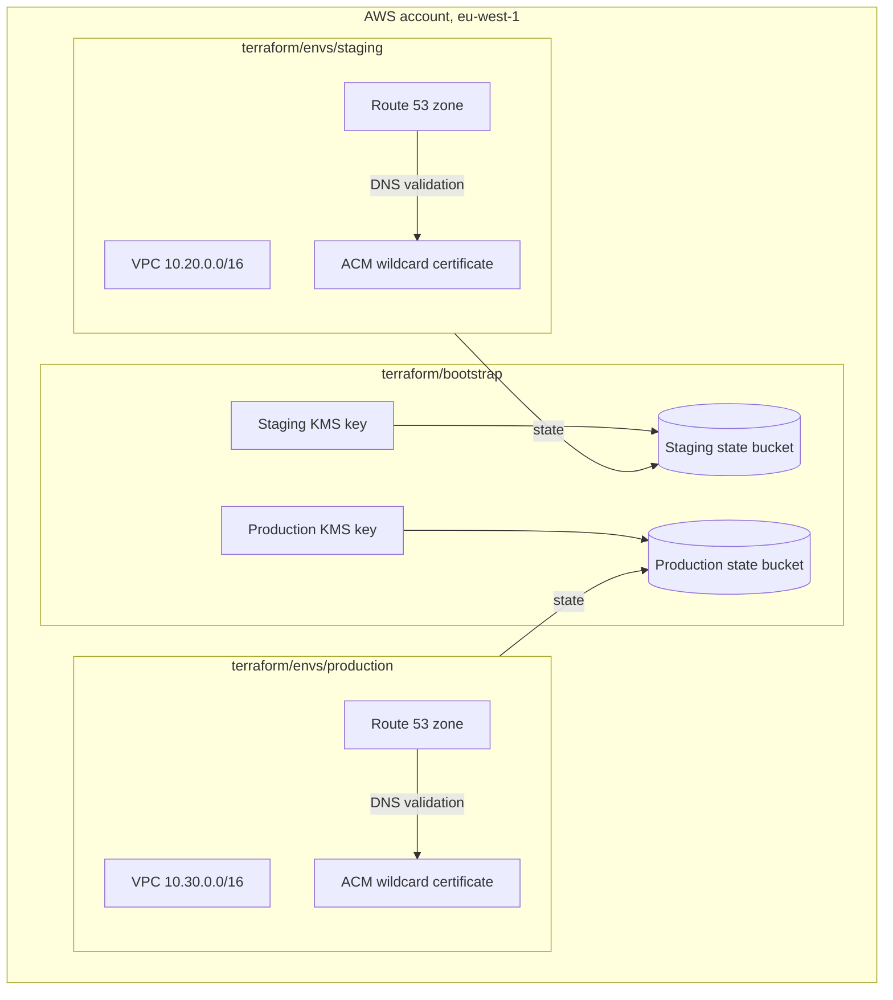
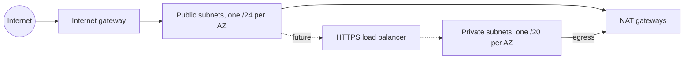

# AWS Foundation Architecture

The AWS landing zone that OpenFlows staging and production run on: remote
Terraform state, one network per environment, and the DNS zone and
certificate each environment's HTTPS ingress uses. EKS, IAM roles and data
services build on top of it.

## Deployment Quick Reference

| | |
|---|---|
| Environments | `staging`, `production` |
| AWS account | `686255958454`, an organization member account shared with other projects (see [ADR-0004](ADR-0004-shared-aws-account.md)) |
| Region | `eu-west-1` |
| Terraform roots | `terraform/bootstrap`, `terraform/envs/staging`, `terraform/envs/production` |
| State | One encrypted, versioned S3 bucket per environment and one for the bootstrap, S3 native locking |
| Networks | `10.20.0.0/16` staging, `10.30.0.0/16` production |
| CI identity | GitHub Actions OIDC, one plan role and one apply role per environment |
| Human access | `openflows-platform-admin` and `openflows-readonly`, both MFA only |
| Apply path | Reviewed PR, then a plan and apply per environment (see [RUNBOOK-aws.md](RUNBOOK-aws.md)) |

## System Overview

Each environment's network spans three availability zones:

## Version Matrix

| Component | Version | Pinned in | Upgrade notes |
|---|---|---|---|
| Terraform | `>= 1.11` | [`terraform/envs/staging/versions.tf`](../terraform/envs/staging/versions.tf) and the other roots | 1.11 is the first release with GA S3 native state locking (`use_lockfile`) |
| AWS provider | `~> 6.70` | [`terraform/envs/staging/versions.tf`](../terraform/envs/staging/versions.tf), [`terraform/bootstrap/versions.tf`](../terraform/bootstrap/versions.tf) | Modules require `>= 6.28`, the floor of the pinned VPC module |
| `terraform-aws-modules/vpc/aws` | `6.7.3` | [`terraform/modules/network/main.tf`](../terraform/modules/network/main.tf) | Read the module changelog before bumping; input names change across majors |

## Components

| Component | Type | Source | Purpose |
|---|---|---|---|
| State buckets | S3 | `terraform/bootstrap` | One per environment plus one for the bootstrap: versioned, KMS-only uploads, public access blocked, TLS only |
| State keys | KMS | `terraform/bootstrap` | One customer-managed key per state bucket, yearly rotation |
| VPC | VPC module | `terraform/modules/network` | Public and private subnets across three AZs, flow logs to CloudWatch |
| NAT gateways | VPC module | `terraform/modules/network` | Private subnet egress: one shared in staging, one per AZ in production |
| Hosted zone | Route 53 | `terraform/modules/dns` | Public DNS for the environment's domain |
| Certificate | ACM | `terraform/modules/dns` | Wildcard certificate for the HTTPS ingress, validated through the zone |
| Permissions boundary | IAM policy | `terraform/bootstrap` | Ceiling on every OpenFlows role: IAM under `/openflows/` only, `openflows-*` buckets only, no changes to resources not tagged `Project=openflows` |
| GitHub OIDC provider | IAM | `terraform/bootstrap` | Lets GitHub Actions assume AWS roles without stored keys |
| `openflows-<env>-terraform-plan` | IAM role | `terraform/bootstrap` | Read-only plans from pull requests and `main` |
| `openflows-<env>-terraform-apply` | IAM role | `terraform/bootstrap` | Applies: staging from `main`, production from `v*` tags; limited to its own environment's tags, IAM path and buckets |
| `openflows-platform-admin`, `openflows-readonly` | IAM roles | `terraform/bootstrap` | Human break-glass and day-to-day access, MFA required |

## Key Decisions

- **One account, isolated by state, network and identity.** See
  [ADR-0004](ADR-0004-shared-aws-account.md).
- **A permissions boundary on every role.** The account hosts other
  projects, so OpenFlows roles are capped by a boundary rather than trusted
  to have narrow policies. Apply roles hold `AdministratorAccess` inside it.
- **CI trust pinned to refs, not GitHub environments.** Private repositories
  on the current GitHub plan cannot protect environments, so the AWS trust
  policy is the gate: production apply only from `v*` tags.
- **Environments are isolated from each other, not only from other projects.**
  Each apply role can only change resources tagged with its own `Environment`,
  only write IAM under `/openflows/<env>/`, and only use `openflows-<env>-*`
  buckets and its own state bucket.
- **The bootstrap owns the shared IAM.** Its roles, the GitHub OIDC provider
  and the boundary cannot be changed by any role that carries the boundary,
  and its state lives in its own bucket that only the platform admin role and
  break-glass principals can reach.
- **One Terraform root per environment.** Each environment has its own state
  file, backend key and inputs, so a staging plan can never touch production
  resources. Shared code lives in `terraform/modules`.
- **S3 native locking, no DynamoDB table.** The backend's `dynamodb_table`
  option is deprecated in favour of `use_lockfile`.
- **Private subnets are /20s.** EKS gives every pod a VPC IP, so private
  subnets are sized for pod density, not node count.
- **Certificate validation waits are opt-in.** ACM can only validate after
  the parent domain delegates to the new zone, so `wait_for_certificate_validation`
  stays `false` until delegation is in place.

## Networking

- Public subnets hold only NAT gateways and, later, internet-facing load
  balancers. Nothing gets a public IP on launch.
- Private subnets hold EKS nodes and data services; they reach the internet
  only through NAT.
- Subnets carry the tags the AWS Load Balancer Controller uses to find them:
  `kubernetes.io/role/elb` on public, `kubernetes.io/role/internal-elb` on private.
- The default security group has every rule removed.
- VPC flow logs go to CloudWatch Logs with 90-day retention.
- The two environments' VPCs are not peered.

## Secrets

The landing zone holds no application secrets. Terraform state can contain
sensitive values, so each state bucket is encrypted with its environment's
KMS key, rejects uploads that request any other encryption, and refuses
non-TLS access. Each bucket denies access except for its environment's plan
and apply roles, the platform admin role, and
`state_break_glass_principal_arns` from the bootstrap root. The bootstrap's
own bucket admits only the platform admin role and break-glass.

## Known Limitations

- Each environment's `zone_name` is not committed yet; it is passed at plan
  time until the domains are decided.
- No CI job plans or applies these roots. Plans and applies are manual and
  follow the change-control process in the runbook.
- Staging uses one NAT gateway, so an AZ outage cuts staging egress.
- The account is shared with other projects; see the consequences in ADR-0004.
  Record changes in other projects' hosted zones cannot be blocked by tag, so
  plan review is the control there.
- Editing the permissions boundary needs a principal without it (the
  bootstrap operator or the account root).

## Key File Locations

| Path | What it holds |
|---|---|
| [`terraform/bootstrap/`](../terraform/bootstrap/) | State buckets, KMS keys, permissions boundary, GitHub OIDC and IAM roles |
| [`terraform/modules/network/`](../terraform/modules/network/) | VPC, subnets, NAT, flow logs |
| [`terraform/modules/dns/`](../terraform/modules/dns/) | Hosted zone and certificate |
| [`terraform/envs/staging/`](../terraform/envs/staging/) | Staging root and inputs |
| [`terraform/envs/production/`](../terraform/envs/production/) | Production root and inputs |
