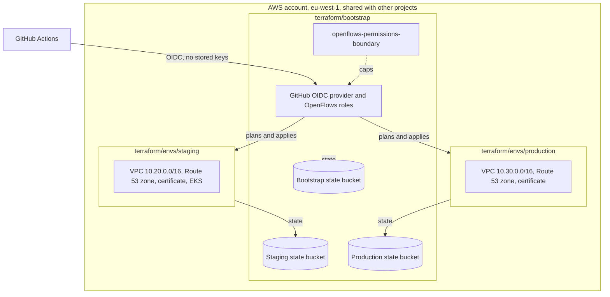
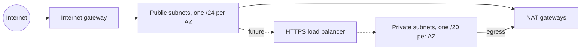
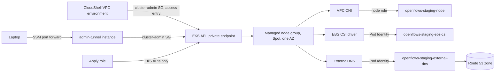
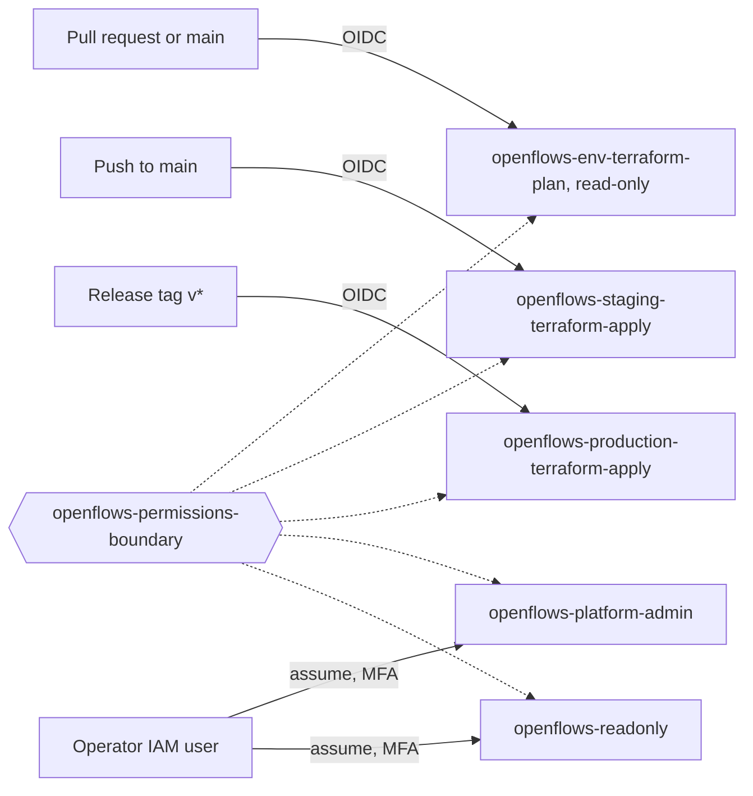
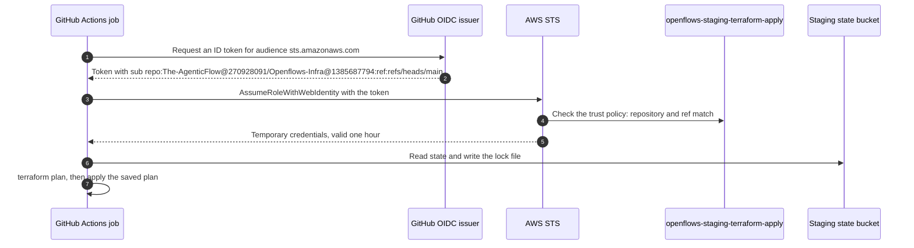
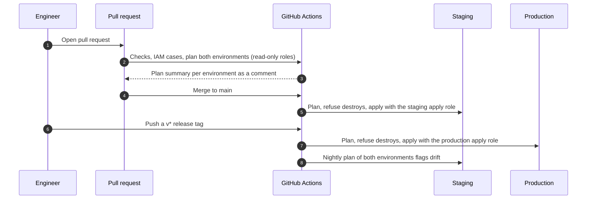
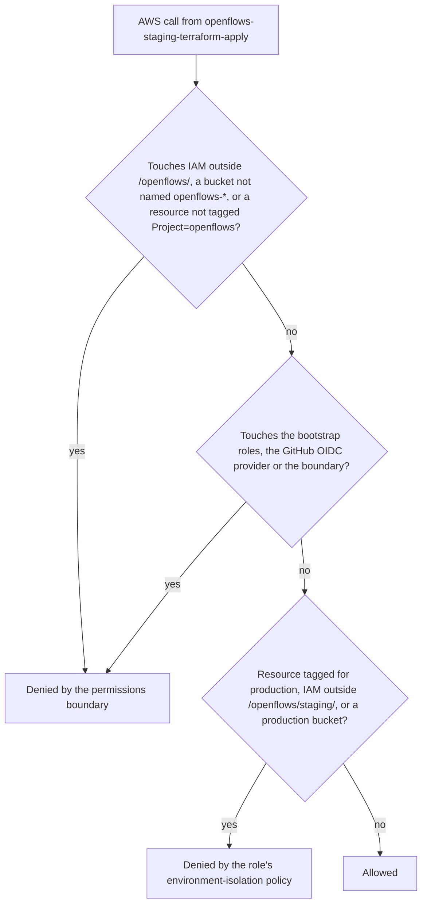

# AWS Foundation Architecture

The AWS landing zone that OpenFlows staging and production run on: remote
Terraform state, one network per environment, and the DNS zone and
certificate each environment's HTTPS ingress uses. EKS, IAM roles and data
services build on top of it.

## Deployment Quick Reference

| | |
|---|---|
| Environments | `staging`, `production` |
| AWS account | `686255958454`, an organization member account shared with other projects (see [ADR-0004](ADR-0004-shared-aws-account.md)) |
| Region | `eu-west-1` |
| State | One encrypted, versioned S3 bucket per environment and one for the bootstrap, S3 native locking |
| Networks | `10.20.0.0/16` staging, `10.30.0.0/16` production |
| Domains | `trial.openflows.dev` staging, `app.openflows.dev` production |
| Kubernetes | EKS cluster `openflows-staging`, private API endpoint; production not built yet |
| CI identity | GitHub Actions OIDC, one plan role and one apply role per environment |
| Human access | `openflows-platform-admin` and `openflows-readonly`, both MFA only |
| Apply path | GitHub Actions: plan on pull requests, staging on `main`, production on `v*` tags |

## System Overview

Three Terraform roots share one AWS account. `terraform/bootstrap` creates
everything the other two depend on: the state buckets, the IAM that GitHub
Actions and people use, and the permissions boundary that caps all of it.
Each environment root then owns its own network, DNS zone and certificate, and
keeps its state in its own bucket.

Each environment's network spans three availability zones:

Inside the staging VPC, the EKS control plane is reachable only from the
private subnets. Nodes run in one private subnet. The VPC CNI uses the node
role (`AmazonEKS_CNI_Policy`); every other add-on that calls AWS gets its own
role through Pod Identity:

## Version Matrix

| Component | Version | Pinned in | Upgrade notes |
|---|---|---|---|
| Terraform | `>= 1.11` | [`terraform/envs/staging/versions.tf`](../terraform/envs/staging/versions.tf) and the other roots | 1.11 is the first release with GA S3 native state locking (`use_lockfile`) |
| AWS provider | `~> 6.70` | [`terraform/envs/staging/versions.tf`](../terraform/envs/staging/versions.tf), [`terraform/bootstrap/versions.tf`](../terraform/bootstrap/versions.tf) | Modules require `>= 6.59`, the floor of the pinned EKS module |
| Terraform CLI in CI | `1.15.8` | [`.github/workflows/terraform.yml`](../.github/workflows/terraform.yml) | Keep at or above the `required_version` floor |
| Trivy in CI | `0.76.1` | [`.github/workflows/terraform.yml`](../.github/workflows/terraform.yml) | Release tarball verified against its checksums file |
| `actions/checkout`, `hashicorp/setup-terraform`, `aws-actions/configure-aws-credentials` | `v7.0.1`, `v4.0.1`, `v6.3.0` | [`.github/workflows/terraform.yml`](../.github/workflows/terraform.yml) | Pinned by commit SHA; check inputs in the new version's `action.yml` before bumping |
| `terraform-aws-modules/vpc/aws` | `6.7.3` | [`terraform/modules/network/main.tf`](../terraform/modules/network/main.tf) | Read the module changelog before bumping; input names change across majors |
| `terraform-aws-modules/eks/aws` | `21.29.0` | [`terraform/modules/eks/main.tf`](../terraform/modules/eks/main.tf) | Recheck what it creates against the boundary before bumping (IAM paths, tags, log group name) |
| Node AMI (EKS optimized AL2023) | `1.37.1-20261023` | [`terraform/envs/staging/terraform.tfvars`](../terraform/envs/staging/terraform.tfvars) | Bumping it rolls the nodes; latest is `aws ssm get-parameter --name /aws/service/eks/optimized-ami/1.37/amazon-linux-2023/x86_64/standard/recommended/release_version` |
| Kubernetes (EKS) | `1.37` | [`terraform/envs/staging/terraform.tfvars`](../terraform/envs/staging/terraform.tfvars) | Standard support ends 2027-12-01; bump the add-on versions in the same change |
| EKS add-ons | `vpc-cni` `v1.22.4-eksbuild.3`, `coredns` `v1.14.7-eksbuild.11`, `kube-proxy` `v1.37.0-eksbuild.22`, `eks-pod-identity-agent` `v1.3.10-eksbuild.3`, `aws-ebs-csi-driver` `v1.67.1-eksbuild.1`, `metrics-server` `v0.9.0-eksbuild.13`, `external-dns` `v0.23.0-eksbuild.2` | [`terraform/modules/eks/main.tf`](../terraform/modules/eks/main.tf) | Each is the default for the Kubernetes version; list with `aws eks describe-addon-versions --kubernetes-version <v>` |
| AWS Load Balancer Controller IAM policy | `v3.6.1`, without Shield and WAF writes | [`terraform/modules/eks/policies/aws-load-balancer-controller.json`](../terraform/modules/eks/policies/aws-load-balancer-controller.json) | Must match the controller chart version Argo CD installs; re-apply the removal of `shield:*Protection` and `wafv2`/`waf-regional` `*WebACL` writes when bumping |

## Components

| Component | Type | Source | Purpose |
|---|---|---|---|
| State buckets | S3 | `terraform/bootstrap` | One per environment plus one for the bootstrap: versioned, KMS-only uploads, public access blocked, TLS only |
| State keys | KMS | `terraform/bootstrap` | One customer-managed key per state bucket, yearly rotation |
| VPC | VPC module | `terraform/modules/network` | Public and private subnets across three AZs with their own route tables, flow logs to CloudWatch |
| NAT gateways | VPC module | `terraform/modules/network` | Private subnet egress: one shared in staging, one per AZ in production |
| Hosted zone | Route 53 | `terraform/modules/dns` | Public DNS for the environment's domain |
| Certificate | ACM | `terraform/modules/dns` | Wildcard certificate for the HTTPS ingress, validated through the zone |
| Permissions boundary | IAM policy | `terraform/bootstrap` | Ceiling on every OpenFlows role: IAM under `/openflows/` only, `openflows-*` buckets only, no changes to resources not tagged `Project=openflows` |
| GitHub OIDC provider | IAM | `terraform/bootstrap` | Lets GitHub Actions assume AWS roles without stored keys |
| `openflows-<env>-terraform-plan` | IAM role | `terraform/bootstrap` | Read-only plans from pull requests and `main` |
| `openflows-<env>-terraform-apply` | IAM role | `terraform/bootstrap` | Applies: staging from `main`, production from `v*` tags; limited to its own environment's tags, IAM path and buckets |
| `openflows-platform-admin`, `openflows-readonly` | IAM roles | `terraform/bootstrap` | Human break-glass and day-to-day access, MFA required |
| EKS cluster | EKS module | `terraform/modules/eks` | Private API endpoint, access entries only (cluster-admin for platform admin, view for read-only), control plane audit and authenticator logs |
| Node group | EKS managed node group | `terraform/modules/eks` | x86 nodes on AL2023 with IMDSv2, hop limit 1, encrypted gp3 root volumes; launch template tags instances, volumes and ENIs |
| Add-ons | EKS add-ons | `terraform/modules/eks` | VPC CNI, CoreDNS, kube-proxy, Pod Identity agent, EBS CSI driver (default StorageClass), metrics-server, ExternalDNS |
| `openflows-<env>-cluster-admin`, `openflows-<env>-admin-tunnel` | Security group, EC2 instance | `terraform/modules/eks` | The only non-node path to the private API: CloudShell VPC environments and an SSM-managed `t4g.nano` that forwards a laptop port, no inbound ports |
| `openflows-<env>-ebs-csi`, `-external-dns`, `-aws-load-balancer-controller` | IAM roles | `terraform/modules/eks` | Pod Identity roles; ExternalDNS may only change the environment's zone |

## Access Model

No AWS key is stored in GitHub, and nobody works as an administrator day to
day. GitHub Actions reaches AWS only through OIDC, and each role trusts a
specific kind of run. People sign in as an IAM user and assume a role with MFA.
Every one of these roles carries the permissions boundary.

## Key Flows

### A GitHub Actions job gets AWS credentials

The job never holds a long-lived key. It trades a short-lived GitHub token for
one hour of AWS credentials, and AWS only agrees if the token comes from this
repository and from the ref the role trusts. The repository issues GitHub's
immutable subject format, which carries the owner and repository IDs, so a
renamed or recreated repository cannot reuse the trust.

### A change goes from pull request to production

Every change reaches AWS the same way, and production only moves when someone
tags a release from `main`. Each apply plans and applies in one job, and stops
if the plan would delete or replace anything.

### How an AWS call from an apply role is decided

`AdministratorAccess` grants the call, then two layers of explicit deny take
it back unless it stays inside OpenFlows and inside the role's environment.

## Key Decisions

- **One account, isolated by state, network and identity.** See
  [ADR-0004](ADR-0004-shared-aws-account.md).
- **A permissions boundary on every role.** The account hosts other
  projects, so OpenFlows roles are capped by a boundary rather than trusted
  to have narrow policies. Apply roles hold `AdministratorAccess` inside it.
- **CI trust pinned to refs, not GitHub environments.** Private repositories
  on the current GitHub plan cannot protect environments, so the AWS trust
  policy is the gate: production apply only from `v*` tags.
- **Environments are isolated from each other, not only from other projects.**
  Each apply role can only change resources tagged with its own `Environment`,
  only change log groups under `/openflows/<env>/` or `/aws/eks/openflows-<env>/`, only write IAM under `/openflows/<env>/`, and only use `openflows-<env>-*`
  buckets and its own state bucket. Every other role an environment root
  creates (pod, node, cluster, flow-log roles) is tagged with its
  `Environment` and held to it by the boundary, which compares the
  resource's `Environment` tag with the caller's.
- **The bootstrap owns the shared IAM.** Its roles, the GitHub OIDC provider
  and the boundary cannot be changed by any role that carries the boundary,
  and its state lives in its own bucket that only the platform admin role and
  break-glass principals can reach.
- **One Terraform root per environment.** Each environment has its own state
  file, backend key and inputs, so a staging plan can never touch production
  resources. Shared code lives in `terraform/modules`.
- **S3 native locking, no DynamoDB table.** The backend's `dynamodb_table`
  option is deprecated in favour of `use_lockfile`.
- **Private subnets are /20s.** EKS gives every pod a VPC IP, so private
  subnets are sized for pod density, not node count.
- **Certificate validation waits are opt-in.** ACM can only validate after
  the parent domain delegates to the new zone, so `wait_for_certificate_validation`
  stays `false` until delegation is in place.
- **The cluster API is private.** Terraform needs only EKS APIs (cluster,
  access entries, add-ons, Pod Identity); people use CloudShell's VPC
  environment; in-cluster changes go through Argo CD.
- **Managed node groups, not Auto Mode.** Auto Mode launches and deletes
  instances and load balancers through our cluster role, which carries the
  boundary, and tags them only `eks:*`. Managed node groups act through an
  AWS service-linked role.
- **Everything the cluster creates is tagged at creation.** The boundary
  decides by `Project` and `Environment` tags, so the launch template, the VPC
  CNI (`ADDITIONAL_ENI_TAGS`), the EBS CSI driver (`extraVolumeTags`) and the
  Load Balancer Controller (`defaultTags`) all set them in the create call.
- **Pod Identity, not IRSA.** Associations are EKS API objects and need no
  per-cluster OIDC provider.
- **No customer KMS key for the cluster.** EKS envelope-encrypts all API data
  with an AWS-owned key on 1.28 and later.
- **Staging nodes are Spot, in one AZ.** Spot cuts node cost; one AZ keeps EBS
  volumes attachable when a node is replaced. Several instance types improve
  Spot availability; burstable types are avoided because unlimited CPU credits
  bill extra.

## Networking

- Public subnets hold only NAT gateways and, later, internet-facing load
  balancers. Nothing gets a public IP on launch.
- Private subnets hold EKS nodes and data services; they reach the internet
  only through NAT.
- Subnets carry the tags the AWS Load Balancer Controller uses to find them:
  `kubernetes.io/role/elb` on public, `kubernetes.io/role/internal-elb` on private.
- The VPC's default security group, network ACL and route table are left as
  AWS creates them and are not used: workloads get their own security groups
  and subnets their own route tables.
- VPC flow logs go to CloudWatch Logs with 90-day retention.
- The two environments' VPCs are not peered.

## Secrets

The landing zone holds no application secrets. Terraform state can contain
sensitive values, so each state bucket is encrypted with its environment's
KMS key, rejects uploads that request any other encryption, and refuses
non-TLS access. Each bucket denies access except for its environment's plan
and apply roles, the platform admin role, and
`state_break_glass_principal_arns` from the bootstrap root. The bootstrap's
own bucket admits only the platform admin role and break-glass.

## Known Limitations

- Each environment's zone only works once the parent `openflows.dev` zone
  delegates to it with NS records. That parent zone lives in the Cloudflare
  account that registered the domain, outside this repository.
- The org's GitHub plan cannot protect environments or branches on this private
  repository, so production is gated by the release tag and the AWS trust
  policy, not by a required reviewer.
- Staging uses one NAT gateway, so an AZ outage cuts staging egress.
- The default security group keeps AWS's default rules (traffic between its
  members). AWS creates it untagged, so the permissions boundary stops
  OpenFlows roles from adopting it, and it cannot be locked down from
  Terraform. Nothing is attached to it.
- The account is shared with other projects; see the consequences in ADR-0004.
  Record changes in other projects' hosted zones cannot be blocked by tag, so
  plan review is the control there.
- Editing the permissions boundary needs a principal without it (the
  bootstrap operator or the account root).
- The boundary is close to IAM's 6,144-character limit for managed policies
  (about 6,120). The next rule added there will need the boundary split, for
  example into one boundary per environment.
- Staging runs one Spot node in one AZ: a Spot reclaim or AZ outage takes
  staging down until a replacement node starts. No cluster autoscaler runs, so
  the node count is whatever `node_desired_size` says.
- The Load Balancer Controller's role is ready, but the controller and Argo CD
  are not installed yet, so there is no HTTPS ingress.

## Key File Locations

| Path | What it holds |
|---|---|
| [`terraform/bootstrap/`](../terraform/bootstrap/) | State buckets, KMS keys, permissions boundary, GitHub OIDC and IAM roles |
| [`terraform/modules/network/`](../terraform/modules/network/) | VPC, subnets, NAT, flow logs |
| [`terraform/modules/dns/`](../terraform/modules/dns/) | Hosted zone and certificate |
| [`terraform/modules/eks/`](../terraform/modules/eks/) | EKS cluster, node group, add-ons, Pod Identity roles, and the IAM cases for the in-cluster roles |
| [`terraform/envs/staging/`](../terraform/envs/staging/) | Staging root and inputs |
| [`terraform/envs/production/`](../terraform/envs/production/) | Production root and inputs |
