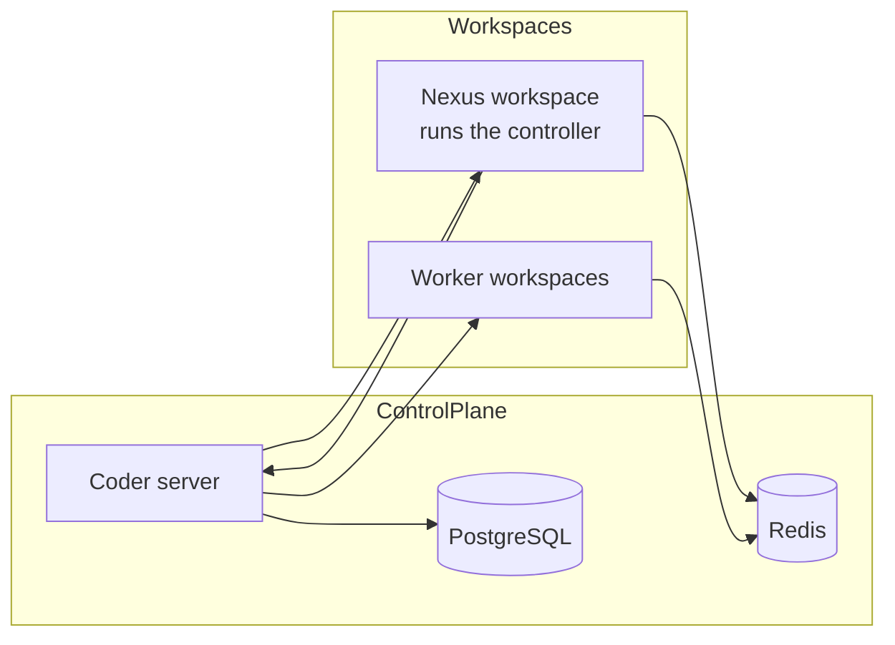
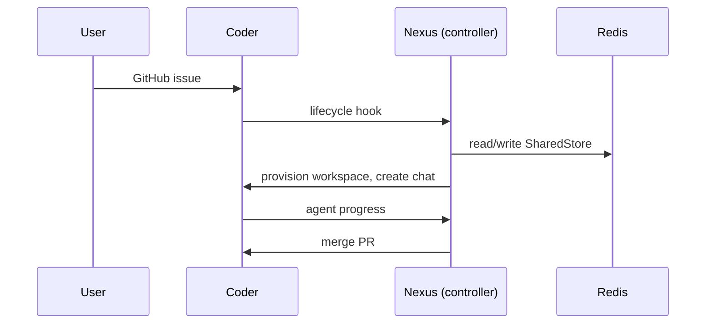

# OpenFlows Architecture

## Deployment Quick Reference

| Fact | Value |
|---|---|
| Namespace | `openflows` (default) |
| Chart | `charts/openflows` |
| Workload shape | 2 StatefulSets (redis, postgres), 1 Deployment (coder); controller runs inside the nexus workspace by default |
| Coder endpoint | `https://coder.example.com` (ingress) |
| Controller hook port | 3001 |
| Provisioner | kubernetes |
| Secret source | `existingSecret` or inline values |
| Deploy mechanism | ArgoCD (`argocd/application.yaml`), tracks `charts/openflows` on `main` |

## System Overview

OpenFlows runs an autonomous AI development team on Coder. Coder governs where
agents run (ephemeral workspaces); OpenFlows governs how they coordinate (the
flow graph, typed state contracts, the planning gate). The control plane is
long-lived and trusted. The worker workspaces are ephemeral and governed.

## Version Matrix

| Component | Version | Pinned in | Upgrade notes |
|---|---|---|---|
| Coder | v2.37.1 | `values.yaml` -> `coder.tag` | Chats API is experimental; pin and verify |
| Redis | 7-alpine | `values.yaml` -> `redis.image` | |
| PostgreSQL | 16-alpine | `values.yaml` -> `postgres.image` | |
| Workspace image | 1.3.3 | `values.yaml` -> `workspace.image` | Runs the embedded controller (`openflows run`) by default |
| OpenFlows image | latest | `values.yaml` -> `controller.tag` | Only used when `controller.enabled=true`; pin to a release tag, not `latest` |

## Components

| Name | Type | Source | Purpose |
|---|---|---|---|
| Redis | StatefulSet | `redis:7-alpine` | OpenFlows SharedStore, single source of truth |
| PostgreSQL | StatefulSet | `postgres:16-alpine` | Coder database |
| Coder | Deployment | `ghcr.io/coder/coder` | Control plane: identity, model gateway, API, provisioner |
| Controller (default) | Process in the nexus workspace pod | Workspace image (`openflows` binary) | Orchestration loop + hook consumer + A2A relay, started by the nexus template's startup script |
| Controller (opt-in) | Deployment | `ghcr.io/the-agenticflow/openflows` | Same role, lifted out of the workspace when `controller.enabled=true` |

## Key Flows

The controller polls Redis every 15 seconds, runs one flow pass, and sleeps.
It is the only component that calls the Coder API to create chats and
provision workspaces. Worker workspaces talk to Redis only through the
`openflows worker` harness.

## Key Decisions

- **In-workspace controller by default.** The controller runs as the
  `openflows run` process inside the nexus workspace pod, started by the
  nexus template's startup script. No separate Deployment to operate when
  there's already exactly one workspace running the control loop. Lift it
  into a standalone Deployment via `controller.enabled=true` to decouple its
  lifecycle from the nexus workspace.
- **Kubernetes provisioner.** Coder creates workspace pods natively instead of
  mounting a docker socket. Requires the RBAC in `coder-rbac.yaml`.
- **Control plane first.** The chart covers Redis, PostgreSQL, Coder, and the
  controller. Workspace templates are pushed by `openflows bootstrap`, not
  part of the chart yet.
- **GitOps via ArgoCD, no external secret backend.** `argocd/application.yaml`
  tracks `charts/openflows` on `main` and syncs automatically on merge.
  Secrets stay as in-cluster Secret objects referenced via `existingSecret`,
  this cluster has no External Secrets Operator or cloud secret manager.
  ArgoCD itself is installed once, out-of-band, it can't sync itself into
  existence.

## Networking

- Coder: ingress on 443, HTTP bind on 7080.
- Controller: hook consumer on 3001, A2A relay on 3000 (localhost only).
- Redis: 6379, cluster-internal.
- PostgreSQL: 5432, cluster-internal.

## Secrets

Secrets are supplied via `existingSecret` (recommended) or inline values
rendered into a Secret. The GitHub App client secret, Coder session token, and
hook secret never appear in the ConfigMap. Never inline a secret value into a
manifest or Helm value.

## Known Limitations

- Workspace templates are not part of the chart. They must be pushed by
  `openflows bootstrap` after install.
- The Postgres password regenerates on `helm upgrade` unless pinned.
- The Coder Chats API is experimental; the chart pins a verified Coder version.

## Key File Locations

| Path | Purpose |
|---|---|
| `charts/openflows/values.yaml` | All chart configuration |
| `charts/openflows/templates/coder-deployment.yaml` | Coder server |
| `charts/openflows/templates/coder-rbac.yaml` | Kubernetes provisioner RBAC |
| `charts/openflows/templates/controller-deployment.yaml` | Controller (only rendered when `controller.enabled=true`) |
| `charts/openflows/templates/secrets.yaml` | Secret rendering |
| `argocd/application.yaml` | ArgoCD Application, GitOps sync from `main` |
