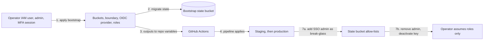

# AWS Foundation Runbook

How to operate the Terraform-managed AWS foundation. What it contains and
why is in [ARCHITECTURE-aws.md](ARCHITECTURE-aws.md).

## Common Operations

### Working in an environment by hand

The pipeline applies every environment change. Work by hand only to
investigate or repair, as `openflows-platform-admin` (see "Assuming the
OpenFlows roles"). Each environment is its own root. Initialise it against its own
state bucket, then plan with the inputs that are not committed yet:

```bash
cd terraform/envs/staging
terraform init -backend-config="bucket=openflows-tfstate-staging-<account-id>"
terraform plan -var="zone_name=<staging-domain or empty>" -out=tfplan
```

Use `terraform/envs/production` and the production bucket for production.
Never copy a plan file between environments, and never commit one: plan
files can contain secret values.

### Change control

Changes reach AWS only through [`.github/workflows/terraform.yml`](../.github/workflows/terraform.yml):

1. A pull request runs `fmt`, `validate`, trivy and the IAM cases, then plans
   staging and production with the read-only plan roles and comments a
   summary per environment (resource lines and totals only).
2. A reviewer other than the author approves and merges it.
3. The merge to `main` applies staging. The job plans, refuses any delete or
   replace, then applies that same plan. A run skips its apply when a later
   commit on `main` changes Terraform or this workflow, so an older merge
   never reverts a newer one; a later docs-only commit does not cause a skip.
4. To release to production, tag the `main` commit that staging already runs
   and push the tag: `git tag v<version> <commit>` then `git push origin v<version>`.
   Only `v*` tags can assume the production apply role, and only the highest
   `v*` tag applies; an older tag pushed later is skipped.
5. A plan that shows an unexpected destroy or replace stops the change until
   the cause is understood. A deliberate removal needs its own reviewed change
   and a manual apply as the platform admin role.

Set an environment's domain with the `ZONE_NAME_STAGING` or
`ZONE_NAME_PRODUCTION` repository variable. While it is empty, the
environment has no hosted zone or certificate.

### State ownership

| State | Bucket | Who may write it |
|---|---|---|
| Bootstrap | `openflows-tfstate-bootstrap-<account-id>` | Platform admin role (read) and break-glass principals |
| Staging | `openflows-tfstate-staging-<account-id>` | Staging plan and apply roles, platform admin role, break-glass principals |
| Production | `openflows-tfstate-production-<account-id>` | Production plan and apply roles, platform admin role, break-glass principals |

Each bucket's policy denies every other principal. The allow-list is built
from the roles in `terraform/bootstrap`, plus `state_break_glass_principal_arns`
in its `terraform.tfvars`. Keep at least one break-glass principal there, or a
bad policy can only be fixed by the account root.

### Assuming the OpenFlows roles

Human access goes through two roles, both requiring MFA:

| Role | Use it for |
|---|---|
| `openflows-readonly` | Looking around, day to day |
| `openflows-platform-admin` | Manual plans and applies, break-glass fixes |

Add a profile per role to `~/.aws/config`, with your IAM user's profile as
the source and your MFA device as `mfa_serial`. The CLI asks for the MFA code
when it assumes the role:

```ini
[profile openflows-admin]
role_arn       = arn:aws:iam::<account-id>:role/openflows/openflows-platform-admin
source_profile = <your-iam-user-profile>
mfa_serial     = arn:aws:iam::<account-id>:mfa/<your-mfa-device>
region         = eu-west-1
```

Both roles carry the permissions boundary, so they cannot touch other
projects' IAM roles, buckets or untagged resources. They also cannot change
the bootstrap's own roles, the GitHub OIDC provider or the boundary: apply
`terraform/bootstrap` as a principal without the boundary (the bootstrap
user before hand-over, an organization administrator, or the account root).

### Bootstrap (first time only)

The state buckets and the pipeline's roles have to exist before any other
root can use them, so the bootstrap is the one apply a person runs by hand.
After it, every change goes through the pipeline and the operator's
administrator rights come off.



1. As an IAM user with administrator rights, in an MFA session (for
   example from `aws sts get-session-token --serial-number <mfa-arn> --token-code <code>`),
   create the buckets, keys, boundary and roles. The committed backend points
   at a bucket that does not exist yet, so start on local state with a
   temporary override file (ignored by git). Review the plan and run the IAM
   cases first (see "Testing the permissions boundary"); every resource must
   be named `openflows-*`.

   ```bash
   cd terraform/bootstrap
   printf 'terraform {\n  backend "local" {}\n}\n' > backend_override.tf
   terraform init
   terraform plan -out=tfplan
   terraform apply tfplan
   ```

2. Move the state into the bootstrap bucket: remove the override, then
   migrate to the committed S3 backend. Answer the copy prompt yourself: if
   Terraform reports that the bucket already holds state, stop and compare
   the two before overwriting anything.

   ```bash
   rm backend_override.tf
   terraform init -migrate-state \
     -backend-config="bucket=openflows-tfstate-bootstrap-<account-id>"
   terraform plan    # must report: No changes
   ```

3. Check the state object is encrypted with the bootstrap KMS key
   (`aws s3api head-object --bucket openflows-tfstate-bootstrap-<account-id> --key terraform.tfstate`
   shows `aws:kms` and that key), then delete the local `terraform.tfstate`,
   `terraform.tfstate.backup` and `tfplan`: they hold the full state. Rerun
   the IAM cases against the real roles with
   `python3 tests/iam_policy_tests.py tests/staging-apply-cases.json --principal <staging-apply-role-arn>`.
4. Set the repository variables the pipeline reads (Settings, Secrets and
   variables, Actions, Variables). None of them is secret. Read each value
   with `terraform output -json <output>` in `terraform/bootstrap`:

   | Variable | Value |
   |---|---|
   | `AWS_ACCOUNT_ID` | The account ID, as in `terraform.tfvars` |
   | `AWS_REGION` | `eu-west-1` |
   | `AWS_ROLE_STAGING_PLAN`, `AWS_ROLE_PRODUCTION_PLAN` | `terraform_plan_role_arns`, per environment |
   | `AWS_ROLE_STAGING_APPLY`, `AWS_ROLE_PRODUCTION_APPLY` | `terraform_apply_role_arns`, per environment |
   | `TF_STATE_BUCKET_STAGING`, `TF_STATE_BUCKET_PRODUCTION` | `state_bucket_names`, per environment |
   | `ZONE_NAME_STAGING`, `ZONE_NAME_PRODUCTION` | Optional. The environment's domain; leave unset to skip DNS |

5. Merge to `main` to let the pipeline apply staging, then push a `v*` tag to
   apply production (see "Change control").
6. Delegate each environment's domain: add the `name_servers` output as NS
   records, named after the subdomain, in the parent `openflows.dev` zone.
   The domain is registered with Cloudflare Registrar, so only the zone in the
   registering Cloudflare account is live; a zone for `openflows.dev` in any
   other account stays Pending and its records are never served. Confirm with
   `dig +short NS <domain> @1.1.1.1`, then set `wait_for_certificate_validation = true`
   for the environment and merge. For production, also push a new `v*` tag,
   so the apply checks the certificate is issued.
7. Hand over from the bootstrap user to the roles. Add
   the account's SSO administrator role to `state_break_glass_principal_arns`
   and apply bootstrap: the buckets' explicit deny would otherwise block it
   too, leaving only the account root to recover a broken policy. Then remove
   `AdministratorAccess` from the bootstrap user and give it only this policy,
   so it can assume the OpenFlows roles with MFA:

   ```json
   {
     "Version": "2012-10-17",
     "Statement": [{
       "Effect": "Allow",
       "Action": "sts:AssumeRole",
       "Resource": [
         "arn:aws:iam::<account-id>:role/openflows/openflows-platform-admin",
         "arn:aws:iam::<account-id>:role/openflows/openflows-readonly"
       ],
       "Condition": { "Bool": { "aws:MultiFactorAuthPresent": "true" } }
     }]
   }
   ```

   Deactivate the bootstrap user's access key once the pipeline runs.

### Testing the permissions boundary

`terraform/bootstrap/tests/` holds the access cases the boundary and the
environment isolation must satisfy: what an apply role can never do (reach
into the other environment, edit its own guard rails, change or relabel other
projects' resources) and what it must still be able to do. Run them after any
change to `boundary.tf` or `roles.tf`, before opening the PR. They use AWS's
policy simulator, which evaluates the documents and changes nothing.

```bash
cd terraform/bootstrap
terraform plan -out=tfplan
tests/render-policies.sh tfplan
python3 tests/iam_policy_tests.py tests/staging-apply-cases.json
```

Every case must pass. Add a case for each new rule, both the deny it is meant
to cause and an allow that must keep working. Once the roles exist, add
`--principal <staging-apply-role-arn>` to test the live role's attached
policies and boundary instead of the rendered files.

CI does the same on every change. When the change touches
`terraform/bootstrap/`, `checks` renders the policies from a plan without
state (a local backend override and `-refresh=false`, so nothing is read from
or written to the bootstrap bucket) and runs the cases against them, so a
guard-rail change is judged before anyone applies it. Otherwise it runs the
cases against the live staging apply role. Either way it also runs
`environment-role-cases.json`, which passes the caller's `Environment` tag as
context to prove every environment role stays in its own environment. Apply
the bootstrap by hand after merging (bootstrap step 1, without the override).

### Break-glass access

Use break-glass access only when the normal deployer path is broken or
locked out, for example a bucket policy that denies everyone.

1. Sign in as the account's break-glass administrator. Its credentials are
   held outside this repository and are never used for routine work.
2. Fix the blocking problem with the smallest possible change. For a
   lockout, remove the `DenyPrincipalsOutsideEnvironment` statement from the
   bucket policy.
3. Restore the intended state from Terraform right away, then record what
   happened and why in an issue.

> [!WARNING]
> A break-glass session can reach both environments. Nothing done in it is
> reviewed, so keep it short and bring the change back into Terraform.

### Reaching the cluster

The EKS API has a public endpoint, so a laptop reaches it directly. IAM
authenticates every request and the access entries authorize it:
`openflows-platform-admin` is cluster-admin, `openflows-readonly` can view.
Without one of those roles the API refuses the call. Nodes use the private
endpoint. Access entries live in
[`terraform/modules/eks/main.tf`](../terraform/modules/eks/main.tf); there is
no `aws-auth` ConfigMap.

#### Giving a teammate access

1. They need an IAM principal in this account with an MFA device and
   permission to call `sts:AssumeRole` on the OpenFlows roles.
2. Add its ARN to `human_principal_arns` in
   [`terraform/bootstrap/terraform.tfvars`](../terraform/bootstrap/terraform.tfvars),
   merge, and apply the bootstrap ("Bootstrap", step 1).
3. They follow "First-time laptop setup".

#### First-time laptop setup

1. Install the AWS CLI and `kubectl` (and `k9s` if you like it).
2. Add a profile that assumes the admin role. With MFA asked by the CLI:

   ```ini
   # ~/.aws/config
   [profile openflows-admin]
   role_arn       = arn:aws:iam::<account-id>:role/openflows/openflows-platform-admin
   source_profile = <your IAM user profile>
   mfa_serial     = arn:aws:iam::<account-id>:mfa/<device>
   region         = eu-west-1
   ```

   Or, if you already keep an MFA session profile (from `aws sts get-session-token`),
   use it as `source_profile` and drop `mfa_serial`.
3. Check it: `aws sts get-caller-identity --profile openflows-admin` prints
   `assumed-role/openflows-platform-admin/...`.

#### Daily use

```bash
# once: writes a context that calls `aws eks get-token` with the profile
aws eks update-kubeconfig --name openflows-staging --region eu-west-1 \
  --profile openflows-admin --alias openflows-staging

kubectl --context openflows-staging get nodes
k9s --context openflows-staging
```

#### Fallback: SSM tunnel

If the public endpoint is ever turned off,
[`scripts/kube-tunnel.sh`](../scripts/kube-tunnel.sh) (needs the
[Session Manager plugin](https://docs.aws.amazon.com/systems-manager/latest/userguide/session-manager-working-with-install-plugin.html))
forwards
`localhost:8443` to the API through the SSM-managed
`openflows-<env>-admin-tunnel` instance (no inbound ports, no SSH keys). It
writes only to `~/.kube/openflows.yaml` (or `$OPENFLOWS_KUBECONFIG`), so
contexts for other clusters are never changed. If `kubectl` stops answering
after heavy traffic, restart the tunnel.

#### From the AWS console

Open CloudShell as `openflows-platform-admin`; the default environment reaches
the public endpoint:

```bash
aws eks update-kubeconfig --name openflows-<env> --region eu-west-1
kubectl get nodes
```

### Upgrading Kubernetes and add-ons

1. List the default add-on versions for the target version:

   ```bash
   aws eks describe-addon-versions --kubernetes-version <v> --addon-name <name> \
     --query 'addons[0].addonVersions[?compatibilities[0].defaultVersion==`true`].addonVersion'
   ```

2. In one pull request, bump `kubernetes_version` and `node_ami_release_version`
   (the target version's release, see "Patching nodes") in the environment's
   `terraform.tfvars`, every version in `local.addon_versions` in
   [`terraform/modules/eks/main.tf`](../terraform/modules/eks/main.tf), plus
   the Version Matrix.
3. Merge for staging; the managed node group rolls its nodes to the new AMI.
   Upgrade one minor version at a time.

### Adding a workload role

Add an entry to the environment's `module "eks"` call:

```hcl
workload_roles = {
  manager = {
    namespace       = "openflows"
    service_account = "manager"
    policy_json     = data.aws_iam_policy_document.manager.json
  }
}
```

It creates `openflows-<env>-manager` with the boundary, path and tags, and
binds it to that service account through Pod Identity. CI then validates the
policy with IAM Access Analyzer in the plan, checks no workload role is an
administrator, and the change needs its own allow and deny IAM cases (the
pre-PR write-action sweep). Accepted Access Analyzer findings, each with its
reason, live in
[`terraform/bootstrap/tests/policy-findings-allowlist.json`](../terraform/bootstrap/tests/policy-findings-allowlist.json).

### Setting the provided secrets

`openflows/<env>/provided` is created empty by Terraform; set its values once,
and again whenever one changes. The command prompts without echoing, so the
values stay out of shell history and logs, and keeps the secret's other keys:

```bash
read -rs -p "GitHub App client secret: " gh; echo
cur=$(AWS_PROFILE=openflows-admin aws secretsmanager get-secret-value --secret-id openflows/staging/provided --query SecretString --output text 2>/dev/null || echo '{}')
AWS_PROFILE=openflows-admin aws secretsmanager put-secret-value \
  --secret-id openflows/staging/provided \
  --secret-string "$(jq -c --arg gh "$gh" '. + {githubClientSecret:$gh}' <<<"$cur")"
unset gh cur
```

External Secrets picks the change up within an hour; to apply it now:
`kubectl -n openflows annotate externalsecret openflows force-sync=$(date +%s) --overwrite`.

### Bootstrapping OpenFlows workspaces

The `openflows-bootstrap` Argo CD app runs `openflows bootstrap` as a Job inside
the cluster: it pushes the workspace templates (nexus, forge, sentinel, vessel,
lore) into Coder. Nothing is built on a laptop. It needs, in order:

1. Coder's admin account, created in the browser at the environment's Coder URL.
   A fresh Coder makes whoever opens it first the owner, so do this right after
   the first deploy.
2. An admin API token (Coder: Settings, Tokens) stored as `coderSessionToken`
   in `openflows/<env>/provided`, keeping the other keys:

   ```bash
   read -rs -p "Coder token: " t; echo
   cur=$(AWS_PROFILE=openflows-admin aws secretsmanager get-secret-value --secret-id openflows/staging/provided --query SecretString --output text)
   AWS_PROFILE=openflows-admin aws secretsmanager put-secret-value --secret-id openflows/staging/provided \
     --secret-string "$(jq -c --arg t "$t" '. + {coderSessionToken:$t}' <<<"$cur")"
   unset t cur
   ```

3. At least one AI model in Coder (AI settings, Providers, then Models);
   bootstrap fails without one.

The Job runs after each sync of `openflows-bootstrap`. To run it again, sync
that app in the Argo CD UI. Bootstrap is idempotent: unchanged templates are
skipped.

```bash
kubectl -n openflows logs job/openflows-bootstrap
```

### Rotating the generated secrets

Increase `generated_version` on `module "app_secrets"` in the environment's
`main.tf` and merge: Terraform writes new values without storing them. Postgres
keeps its password inside its data volume, so for a Postgres rotation run
`ALTER USER coder PASSWORD '<new>'` in the database first. Then refresh the
Kubernetes Secrets before restarting their consumers, or they read the old value:

```bash
for es in openflows-postgres openflows-chat-hook; do
  kubectl -n openflows annotate externalsecret $es force-sync=$(date +%s) --overwrite
done
kubectl -n openflows wait externalsecret openflows-postgres openflows-chat-hook --for=condition=Ready --timeout=2m
kubectl -n openflows rollout restart statefulset/openflows-postgres deployment/openflows-coder
```

### Bootstrapping Argo CD

Once per cluster, from a laptop or CloudShell as
`openflows-platform-admin` (see "Reaching the cluster"). The repository is
public, so Argo CD needs no Git credential.

```bash
kubectl config use-context openflows-staging   # the context from "Daily use"
helm upgrade --install argocd argo-cd --repo https://argoproj.github.io/argo-helm \
  --version 10.11.1 --namespace argocd --create-namespace \
  -f gitops/argocd/values-staging.yaml
kubectl apply -f gitops/staging/root.yaml
```

From then on, merging to `main` is the only way changes reach the cluster:
`staging-root` syncs every Application in `gitops/staging/apps/`. To open the
UI, keep the tunnel running and in another terminal:

```bash
kubectl -n argocd port-forward svc/argocd-server 8080:80
kubectl -n argocd get secret argocd-initial-admin-secret -o jsonpath='{.data.password}' | base64 -d
```

Then browse to `http://localhost:8080` as `admin`. Delete
`argocd-initial-admin-secret` after the first sign-in.

### Patching nodes

Node AMIs are pinned by `node_ami_release_version` in the environment's
`terraform.tfvars`, so applies never roll nodes by surprise. To patch, read the
latest release and bump the pin in a pull request; the managed node group then
replaces nodes one at a time:

```bash
aws ssm get-parameter --name /aws/service/eks/optimized-ami/1.37/amazon-linux-2023/x86_64/standard/recommended/release_version --query Parameter.Value --output text
```

### Changing node size or count

Edit `node_instance_types`, `node_desired_size`, `node_min_size` or
`node_max_size` in the environment's `terraform.tfvars` and merge. Keep
several instance types for Spot. No cluster autoscaler runs, so
`node_desired_size` is the node count.

## Backup & Restore

State buckets are versioned and keep superseded versions for 90 days. To
recover from a bad state write, list the versions and restore the last good
one:

```bash
aws s3api list-object-versions \
  --bucket openflows-tfstate-staging-<account-id> \
  --prefix envs/staging/terraform.tfstate
aws s3api copy-object \
  --bucket openflows-tfstate-staging-<account-id> \
  --key envs/staging/terraform.tfstate \
  --copy-source "openflows-tfstate-staging-<account-id>/envs/staging/terraform.tfstate?versionId=<version-id>"
```

The buckets have `prevent_destroy`, so Terraform refuses to delete them.

## Monitoring & Alerts

- VPC flow logs are in CloudWatch Logs, in `/openflows/<env>/vpc-flow-log/<vpc-id>`.
  Name every new OpenFlows log group under `/openflows/<env>/`: the guard
  rails decide log group retention and deletion by that name, not by tags.
  EKS control-plane logs are the one exception, in `/aws/eks/openflows-<env>/cluster`,
  because EKS fixes that name.
- EKS control plane audit and authenticator logs are in `/aws/eks/openflows-<env>/cluster`.
- No alerts are defined on the foundation yet.
- The nightly `Terraform` workflow run plans both environments and fails on
  drift: a red nightly run means AWS no longer matches `main`. Read its plan
  summary, then either revert the manual change or bring it into Terraform.

## Troubleshooting

| Symptom | Likely cause | Fix |
|---|---|---|
| `AWS account ID not allowed` | Credentials for a different account | Switch credentials; `allowed_account_ids` stops the run on purpose |
| `kubectl` says `Unauthorized` or `You must be logged in` | The profile is not an OpenFlows role, or the MFA session expired | Refresh the MFA session, then check `aws sts get-caller-identity --profile openflows-admin` |
| A `ClusterSecretStore` shows `InvalidProviderConfig: no EC2 IMDS role found` | The External Secrets pod started before its Pod Identity association existed (first install), so it has no AWS credentials | `kubectl -n external-secrets rollout restart deploy/external-secrets`; the same applies to any pod whose Pod Identity association was created after it started |
| `openflows-bootstrap` Job pod stays `CreateContainerConfigError` | `coderSessionToken` is not in `openflows/<env>/provided` yet | Store the token ("Bootstrapping OpenFlows workspaces"); the pod starts once External Secrets syncs it |
| Bootstrap fails with no LLM models configured | No AI model in Coder yet | Add a provider and model in Coder's AI settings, then sync `openflows-bootstrap` again |
| `kubectl` returns `Unauthorized` | The signed-in principal has no access entry (for example the bootstrap IAM user) | Assume `openflows-platform-admin` or `openflows-readonly` first |
| Pods stuck `ContainerCreating` with `failed to assign an IP` or a volume that will not attach, and an `explicit deny in a permissions boundary` in CloudTrail | An ENI or volume was created without `Project` and `Environment` tags | Check the VPC CNI `ADDITIONAL_ENI_TAGS` and EBS CSI `extraVolumeTags` add-on settings; run the in-cluster IAM cases in `terraform/modules/eks/tests` |
| A stateful pod stays `Pending` after a node replacement | Its EBS volume is in a different AZ from the new node | Staging nodes use one AZ for this reason; keep `node_az_count = 1` there |
| `Error acquiring the state lock` | An interrupted run left its `.tflock` object | Confirm no run is active, then `terraform force-unlock <lock-id>` |
| `AccessDenied` on the state bucket | Principal is not one of the environment's roles or a break-glass principal | Use the environment's role, or add the principal to `state_break_glass_principal_arns` and apply bootstrap |
| `AccessDenied ... explicit deny in a permissions boundary` | The action touches IAM outside `/openflows/`, a bucket not named `openflows-*`, a resource not tagged `Project=openflows`, or a bootstrap-managed role | Name and tag the resource as OpenFlows; for bootstrap changes, apply as a principal without the boundary |
| `AccessDenied ... explicit deny in an identity-based policy` from an apply role | The resource, IAM path or bucket belongs to the other environment, or a new log group is named outside `/openflows/<env>/` and `/aws/eks/openflows-<env>/` | Tag the resource with the right `Environment`, put roles under `/openflows/<env>/`, name buckets `openflows-<env>-*` |
| GitHub Actions `Not authorized to perform sts:AssumeRoleWithWebIdentity` | The job runs from a ref the role does not trust, sets `environment:`, or the repository's OIDC subject prefix changed | Plans: pull requests or `main`. Staging apply: `main`. Production apply: a `v*` tag. Do not set `environment:` on these jobs. Compare `sub_claim_prefix` from `gh api repos/<owner>/<repo>/actions/oidc/customization/sub` with `github_oidc_subject_prefix` in the bootstrap |
| Apply hangs on `aws_acm_certificate_validation` | The parent domain does not delegate to the zone yet | Add the NS records, or set `wait_for_certificate_validation = false` |
| NS records added in Cloudflare but `dig NS <domain> @1.1.1.1` returns nothing | They went into a Pending `openflows.dev` zone in an account that did not register the domain | Add them in the account whose zone is Active, the one listing the domain under Domain Registration |

## Rollback Procedure

Revert the PR, re-plan the affected environment and apply. If an apply left
state wrong, restore the previous state version as in "Backup & Restore",
then plan to see what the real infrastructure looks like before applying.

## Escalation

If a plan shows destroys or replacements nobody can explain, or production
is affected, stop and raise it with the platform owners before applying
anything else.
